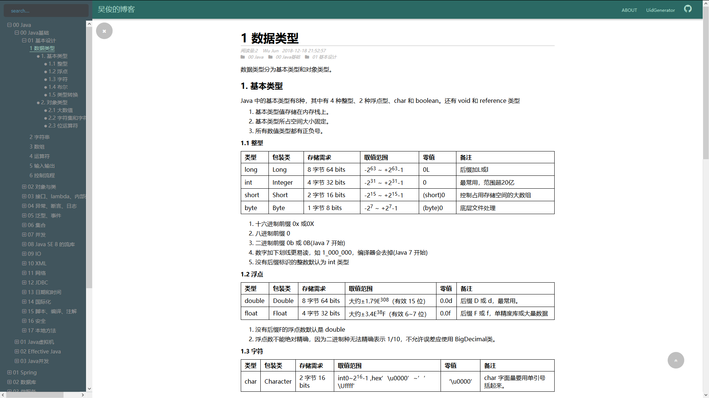

# Hexo 主题 Tree

一个简洁的主题，主要功能是 “树状导航” + “树状目录”，可选配“评论”和“阅读量”功能，支持基于搜索引擎的全站搜索。通过 fancybox 支持图片点击放大。

有问题欢迎及时 issues

Demo：[https://wujun234.com/](https://wujun234.com/)



# 下载主题

下载主题(可选择 release 版本)到 `hexo` 根目录中 `themes` 目录下
```
git clone https://github.com/wujun234/hexo-theme-tree.git  themes/tree
```

修改 `hexo` 根目录的 `_config.yml`
```
theme: tree
```
# 配置主题
## 0 默认配置
为了将 个人配置 跟 主题更新 解耦，目前将之前放在 `themes/tree/_config.yml` 的的配置项移到了 `hexo` 根目录中的 `_config.yml` 文件。

**旧版**：无感升级，因为 themes 下的配置是继承 hexo config 的

请复制粘贴下面默认配置到 `hexo` 根目录中的 `_config.yml` 文件中(或者新建 `_config.tree.yml` 文件)，后续可以根据自己需求更改配置

```
########## The following are all optional #########
####### footer bar #####
# footer, author name
author: your name
# footer, author name link
website: /
# footer, copyright start year, default this year
#siteStartYear: 2018
# favicon, replaceable
favicon: /favicon.ico

####### header bar #####
# before set to true, please maker sure you've created hexo tags\categories\about pages
tags: false
categories: false
about: false
links:
    # GitHub links，start with http、https or //
    github: https://github.com/wujun234
    # normal links，support multiple
    custom:
      - name: Tree
        URL: https://github.com/wujun234/hexo-theme-tree
      - name: UidGenerator
        URL: https://github.com/wujun234/uid-generator-spring-boot-starter

####### sidebar #####
sidebar:
    # name for left sidebar post list. true: title name; false: file name
    usePostTitle: true

    # Prefix for each entry of the article table of contents, HTML allowed.
    # The default is a solid circle: '<i class="fa fa-circle" aria-hidden="true"></i>'
    # You may set the prefix to `#`:
    # headerPrefix: '<span>#</span>'
    # You may also remove the prefix with an empty string:
    # headerPrefix: ''

####### plug-in #####
# optional, giscus comment
# get generated configurations from https://giscus.app/
# when enable is true, full out your repo、repo_id、category_id
giscus:
    enable: false
    repo:
    repo_id:
    category_id:
    reactions_enabled: "1"
    emit_metadata: "0"
    input_position: "top"
    theme: "preferred_color_scheme"
    lang: "en"
# optional, GoatCounter, statistics of visits
goatcounter:
    # Site code is the <site-code> in https://<site-code>.goatcounter.com
    site_code:
    # track every page and show the total in the footer
    site_counter: false
    # show the view count on post pages
    post_counter: false
# optional, valine
valine:
    enableComment: false
    enableCounter: false
    # valine appID
    appID:
    # valine appKey
    appKey:
    placeholder: Please enter a comment
    avatar: retro
#optional, busuanzi, statistics of visits
busuanzi: false

####### Off-page search #####
# If the site is [included by a search engine]
# searchEngine：default google, can replace with other searchEngine
#searchEngine: https://www.baidu.com/s?wd=
searchEngine: https://www.google.com/search?q=
# homeHost：target domain, default current page domain
homeHost: wujun234.com
```

## 1 导航栏和网站图标
### 网站图标
替换`themes/tree/source` 路径下的`favicon.ico` 文件

### 自定义链接
- 导航栏：配置化，需要在 `hexo` 根目录中的 `_config.yml`，需要修改 `links` 相关配置
```
# optional
links:
    # github links，start with http、https or //
    github:  https://your github link
    # normal links，support multiple
    custom:
        - name:
          URL:
        - name:
          URL:
```

### about 页
在 `source` 路径下，与 `_posts` 文件夹平行，建立一个 `about` 页

执行
```
hexo new page --path about/index "About"
```
参考：https://hexo.io/zh-cn/docs/commands.html#new

修改 `hexo` 根目录中的 `_config.yml`，添加
```
about: true
```
### tags 页
在 `source` 路径下，与 `_posts` 文件夹平行，建立一个 `tags` 页

执行
```
hexo new page "tags"
```
编辑 source/tags/index.md
```
---
title: tags
date: 2021-02-26 16:36:55
type: "tags"
layout: "tags"
---
```
修改 `hexo` 根目录中的 `_config.yml`，添加
```
tags: true
```
如果想让 tags 页展示在一列，可以添加配置
```
style:
    tags:
        # support line, list; default list
        display: line
```
### categories 页
在 `source` 路径下，与 `_posts` 文件夹平行，建立一个 `categories` 页

执行
```
hexo new page "categories"
```
编辑 source/tags/index.md
```
---
title: categories
date: 2021-02-26 16:36:55
type: "categories"
layout: "categories"
---
```
修改 `hexo` 根目录中的 `_config.yml`，添加
```
categories: true
```
如果想让 categories 页展示在一列，可以添加配置
```
style:
    categories:
        # support line, list; default list
        display: line
```

## 2 文章树、目录树
页面左侧的文章树是根据 source 文件夹里的文章和文件夹生成的

修改 `hexo` 根目录的 `_config.yml`, `sidebar.usePostTitle` 可以控制目录树中展示文件名还是文章名
```
# name for left side bar post list
sidebar:
    # ture: title name; false: file name
    usePostTitle: true
```

## 3 评论与访问统计
### Giscus
- 如果要使用 `giscus` 评论系统，需要在 `hexo` 根目录中的 `_config.yml`，填写 `giscus` 配置
- 配置页面：https://giscus.app
- 默认是不使用，false

```
# optional, giscus comment
# get generated configurations from https://giscus.app/
# when enable is true, full out your repo、repo_id、category_id
giscus:
    enable: false
    repo:
    repo_id:
    category_id:
    reactions_enabled: "1"
    emit_metadata: "0"
    input_position: "top"
    theme: "preferred_color_scheme"
    lang: "zh-CN"
```

### GoatCounter

- 如果想统计访问量，可以用 GoatCounter。它把计数托管在 goatcounter.com，统计脚本是一个公开的 JS，数据可以在线看，也可以随时导出。
- 在 <https://www.goatcounter.com/signup> 注册，GoatCounter 的 site code 就是访问地址的子域名：`https://<site-code>.goatcounter.com`。
- 注册后要在 GoatCounter 的设置里打开 `Allow adding visitor counts on your website`，否则文章页拿不到计数。
- 配置：

```
# optional, GoatCounter
goatcounter:
    site_code: <site-code>
    # 统计全站，页脚显示总访问量
    site_counter: true
    # 文章页显示阅读量
    post_counter: true
```

- `site_counter` 打开后所有页面都会上报给 GoatCounter，页脚也会显示总访问量；`post_counter` 打开后文章页才会显示阅读量。两个可以独立开关，比如只想要全站统计，就把 `post_counter` 设成 false。
- GoatCounter 默认按 visit 计数，同一个路径 8 小时内只算一次；想要接近页面浏览（PV）的口径，可以在它的设置里关掉 sessions。

### Valine

> 注意：LeanCloud 将于 2027-01-12 停服，Valine 的评论和阅读量都依赖 LeanCloud，慎用。

- 如果要使用 `valine` 的评论及阅读量功能，需要在 `hexo` 根目录中的 `_config.yml` 文件中，填写自己申请的 `leancloud` 账户下面的 `appID` 和 `appKey`，并且分别设置为 true
- 默认是不使用，false

```
# optional, valine
valine:
    enableComment: false
    enableCounter: false
    # valine appID
    appID:
    # valine appKey
    appKey:
    placeholder: Please enter a comment
    avatar: retro
```

## 4 全站搜索
修改 `hexo` 根目录的 `_config.yml`

站点如果【被搜索引擎收录】，可以配置通过搜索引擎全站搜索
- searchEngine: 你选择的搜索引擎搜索 url，默认谷歌，例如"https://www.baidu.com/s?wd="、"https://www.google.com/search?q="
- homeHost: 你的域名，默认当前页面的域名
```
####### Off-page search #####
# If the site is [included by a search engine]
# searchEngine：default google, can replace with other searchEngine
#searchEngine: https://www.baidu.com/s?wd=
searchEngine: https://www.google.com/search?q=
# homeHost：target domain, default current page domain
homeHost: wujun234.com
```

## 5 pjax
~~主题默认支持了 pjax 跳转，但是在网速慢的时候，pjax 因为没有页面刷新的交互，可能会让人误以为点击没响应。~~

~~如果要去掉 pjax 特性，注释掉主题 'source/js/main.js' 文件中的 'pjaxLoad()' 方法就好。~~

默认注释了，需要打开的就去掉注释

```js
$(document).ready(function () {
  hljs.initHighlightingOnLoad();
  clickTreeDirectory();
  serachTree();
  // pjaxLoad();
  showArticleIndex();
  switchTreeOrIndex();
  scrollToTop();
  pageScroll();
  wrapImageWithFancyBox();
});
```

## 6 国际化（i18n）
- 国际化：需要在 `hexo` 根目录的 `_config.yml`，需要修改 `language` 相关配置
- 小试牛刀，目前搜索框、导航栏和配置检查的报错有文字
```
# support language
# default en， can select from [en, zh-Hans, tr]
language: zh-Hans
```

# 其他
## 图片
最开始将图片放在 source 中，使用 github 的相对地址，但是本地 md 编辑器不能识别这样的图片，

后续选择了 picgo，用 github 做图床：https://picgo.github.io/PicGo-Doc/

##  推荐插件
以下插件都是 hexo 的，跟 Tree 主题无关

- 渲染器：[hexo-renderer-markdown-it](https://github.com/hexojs/hexo-renderer-markdown-it)
- 流程图：[hexo-filter-mermaid-diagrams](https://github.com/webappdevelp/hexo-filter-mermaid-diagrams)
- 通用 sitemap: [hexo-generator-sitemap](https://github.com/hexojs/hexo-generator-sitemap)
- 百度 sitemap：[hexo-generator-baidu-sitemap](https://github.com/coneycode/hexo-generator-baidu-sitemap)
- 一键部署: [hexo-deployer-git](https://github.com/hexojs/hexo-deployer-git)
## 访问管理
~~我自己用的是百度统计 https://tongji.baidu.com ，很简单，注册后在 'head' 里加一个 '<script>' 块就行了~~

现在改用 Cloudflare 了，免费，接入 DNS，会有统计，还有分析。
